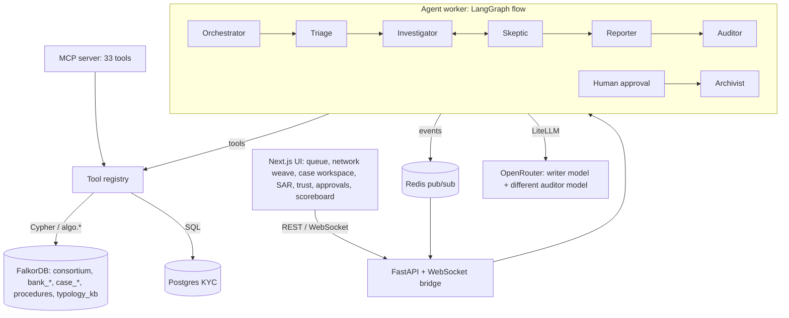

# BankWeave

**Many banks, one ring, every claim proven.**

BankWeave is a team of AI agents that investigates money-laundering alerts across several
banks, with FalkorDB as its shared brain. It clears innocent alerts fast, exposes laundering
rings that no single bank can see, and backs every conclusion with a graph path you can click
through. It also knows how many *independent* reasons it has for each belief, notices when one
of them dies, and refuses to file a report it can't prove.

- **Tracks:** 01 Agents That Act on Connected Data (primary), 02 Agent Memory and Coordination, Best blog post
- **Live demo:** _link added at deployment_
- **Demo video:** _link added after recording_
- **Blog post:** [`docs/BLOG.md`](docs/BLOG.md)

BankWeave is an independent hackathon project. It is not a FalkorDB product and is unrelated to
FalkorDB's QueryWeaver or Weights & Biases Weave.

---

## The problem

1. **Alert fatigue.** Rule-based transaction monitoring flags single signals without context;
   industry sources put 85-95% of alerts as false positives.
2. **Fragmented visibility.** A bank only sees transactions that touch it. Laundering schemes
   spread across institutions, so each bank's slice looks innocent.
3. **Unprovable reports.** A suspicious activity report (SAR) has to justify itself, and today
   that justification is assembled by hand.

## What BankWeave does

1. Loads IBM's public synthetic AML data into **one isolated FalkorDB graph per bank** plus a
   **consortium graph** that links them with salted, hashed account ids.
2. A team of agents (Orchestrator, Triage, Investigator, Skeptic, Reporter with a separate
   Auditor, Archivist) works the alert queue through a **task blackboard stored in the graph**,
   calling **native FalkorDB algorithms as tools** (also served over MCP).
3. Innocent alerts are cleared in milliseconds with a reason; suspicious ones become **cases**,
   each in its own `case_<id>` graph, where claims are linked to evidence and the query that
   produced it.
4. A **trust layer** built from three 2026 papers keeps the agents honest (below).
5. Humans approve every action. Everything is measured against IBM's labels on a scoreboard.

## Why FalkorDB is essential

Turn FalkorDB off and BankWeave can't do any of its core work:

| Without the graph… | because |
|---|---|
| no ring is visible | the ring only exists as a path *between* banks; the consortium graph is where it connects (see E2) |
| triage can't clear anything | components, motif scores, cross-bank links and shared identity are all graph queries |
| no claim has evidence | evidence is a path, an algorithm score or a shared attribute in the graph, stored with its query |
| confidence can't be computed | echo-proof confidence counts distinct `origin`s over `SUPPORTED_BY` edges |
| invalidation can't cascade | dependencies are typed edges (`SUPPORTED_BY`, `DERIVED_FROM`, `JUSTIFIED_BY`, `CITES`) |
| agents can't coordinate or resume | tasks, heartbeats and the case timeline live in the graph |

FalkorDB features in use: **multigraph** (per-bank, consortium, per-case, procedures, typology KB
graphs in one instance), **native algorithms** (`algo.wcc`, `algo.labelPropagation`,
`algo.pageRank`, `algo.betweenness`, `algo.HarmonicCentrality`, `algo.SPpaths`, `algo.SSpaths`,
`algo.maxFlow`, `algo.bfs`, `algo.MSF`), **full-text indexes** with Double Metaphone phonetic
matching and English stemming, a **vector index** (HNSW) on behaviour profiles, and the Redis
protocol for live pub/sub.

## Proof: every FalkorDB feature BankWeave uses

| Feature | Where in the code | Evidence it runs |
|---|---|---|
| **Multigraph** (isolated graphs in one instance) | `consortium`, `bank_<id>`, `case_<id>`, `procedures`, `typology_kb` (`backend/app/db.py`) | Browser shows 43-188 graphs during a run; FalkorDB Cloud holds `consortium` + 6 bank graphs + `typology_kb` |
| `algo.wcc` | precompute component sizes; triage islands (`detection/precompute.py`, `detection/algorithms.py`) | E7 timing; triage reasons "isolated cluster" in the alert queue |
| `algo.labelPropagation` | communities (`detection/precompute.py`) | `Account.community` on every account |
| `algo.pageRank` | hub finding in case graphs; SPNSA intermediaries |  hub claim; E7 timing |
| `algo.betweenness` (seeded) | mule bridges; SPNSA |  |
| `algo.HarmonicCentrality` | orchestrator candidates | `find_orchestrator` tool, rebuttal rounds |
| `algo.SPpaths` | money paths: the primary evidence of a claim | `path` evidence in every case, with its query |
| `algo.SSpaths`, `algo.bfs` | `reach`, `bfs_reach` tools (case graph) | available to the Investigator and over MCP |
| `algo.maxFlow` | money at risk over collapsed `FLOWS` edges | hub claims cite max-flow evidence |
| `algo.MSF` | `backbone` tool: a ring's spanning backbone | available to the Investigator, Reporter and over MCP |
| Full-text index + **Double Metaphone** | `Person.name`, `Company.name` (`detection/identity.py`) | `test_identity.py`: a spelling variant finds its original identity |
| Full-text index + **English stemming** | typology knowledge graph (`knowledge/typology_kb.py`) | cited answers; abstains on unrelated questions |
| **Vector index (HNSW, cosine)** | 16-dim behaviour profiles (`app/services/loader.py`) | `behavior_neighbors`, triage features, clue expansion |
| Range indexes incl. **relationship property index** | `TRANSFERS.ts`, `TRANSFERS.txn_id` | `CALL db.indexes()` |
| Parameterised Cypher, `ro_query` for reads | every query (`docs/QUERIES.md`, 190 queries) | read-only MCP tool `cypher_readonly` |
| Concurrent writers on one graph | task blackboard (`agents/blackboard.py`) | `test_blackboard.py`: 6 threads, 20 tasks, each claimed once |
| FalkorDB Browser | visual inspection of every graph | screenshots below |
| FalkorDB Cloud | live instance (ap-south-1) seeded with the IBM slice | `scripts/make_slice.py` + seed log |

| The consortium ring in FalkorDB Browser | A case graph: claims and their evidence |
|---|---|
|  |  |

| One bank's view (fragments) | Consortium view (one ring across 4 banks) |
|---|---|
|  |  |

| Alert queue on real IBM data | Case workspace |
|---|---|
|  |  |

## Architecture



The LLMs plan, choose tools and write prose. Cypher and `algo.*` do the computation. With no
API key the agents run a deterministic policy (labelled as such in the UI), so the system is
always runnable.

## Graph model

Full schema: [`docs/GRAPH_MODEL.md`](docs/GRAPH_MODEL.md). In short:

- `consortium`: `Account` (hashed id, bank, degrees, PageRank, component, community, motif
  score, pass-through stats, 16-dim behaviour vector) `-[:TRANSFERS]->` `Account`, a collapsed
  `-[:FLOWS]->` edge per account pair, the identity layer (`Person`/`Company` `-[:OWNS]->`;
  `USES_DEVICE`, `USES_IP`, `REGISTERED_AT`), `Alert`, `Decision`, blackboard `Task`, case mirrors.
- `bank_<id>`: the bank's own `Account`s plus `ExternalAccount` stubs; only transfers touching
  the bank.
- `case_<id>`: `Claim -[:SUPPORTED_BY|CHALLENGED_BY]-> Evidence {origin, cypher}`,
  `Claim -[:DERIVED_FROM]-> Claim`, `Action -[:JUSTIFIED_BY]-> Claim`,
  `SAR -[:CONTAINS]-> Sentence -[:CITES]-> Evidence|Claim`, `Evidence -[:SUPERSEDES]-> Evidence`,
  `Case -[:HAD_EVENT]-> Event -[:NEXT]-> Event`.

## Cypher queries and algorithms

Every query the product runs is listed in [`docs/QUERIES.md`](docs/QUERIES.md), generated from
the code. A few that carry the product:

```cypher
// echo-proof confidence: count independent origins, not paths
MATCH (c:Claim {id:$id})-[:SUPPORTED_BY]->(e:Evidence)
WHERE e.state IN ['active', 'needs_verification']
RETURN count(e) AS paths, count(DISTINCT e.origin) AS independent_sources

// money path between two accounts: the primary evidence for a claim
MATCH (s:Account {id:$src}), (d:Account {id:$dst})
CALL algo.SPpaths({sourceNode:s, targetNode:d, relTypes:['TRANSFERS'],
                   maxLen:$max_len, pathCount:$path_count, relDirection:$direction})
YIELD path, pathWeight
RETURN [n IN nodes(path) | n.id] AS accounts, [t IN relationships(path) | t.txn_id] AS txn_ids

// money at risk: max flow from flagged accounts to the hub (collapsed FLOWS edges)
CALL algo.maxFlow({sourceNodes:srcs, targetNodes:tgts, relationshipTypes:['FLOWS'],
                   capacityProperty:'capacity', nodeLabels:['Account']})
YIELD maxFlow, edges, edgeFlows

// premise check: does this action rest on overturned evidence?
MATCH (a:Action {id:$id})-[:JUSTIFIED_BY]->(c:Claim)
OPTIONAL MATCH (c)-[:SUPPORTED_BY|DERIVED_FROM*1..5]->(e:Evidence {state:'superseded'})
RETURN c.id, collect(e.id) AS stale
```

Things FalkorDB doesn't ship natively, done in plain Cypher (and said so): degree
(precomputed), time-ordered cycles (iterative time-respecting expansion, one query per hop),
3-cycles (motif score), eigenvector centrality (PageRank used instead in SPNSA).

## Agents and MCP tools

| Agent | Does |
|---|---|
| Orchestrator | turns open alerts into blackboard tasks, resets stale claims |
| Triage | clears an alert with a reason, or opens a case graph |
| Investigator | chooses graph tools (LLM) or follows a learned procedure; writes evidence-linked claims; cites named typologies |
| Skeptic | argues the innocent explanation with KYC facts and attribute-sharing context; at most 2 rounds |
| Reporter + Auditor | SAR through the provenance gate; a different, stronger model audits |
| Archivist | saves the tool sequence that worked (procedural memory), closes the case |

The MCP server (`python -m mcp_server.server`, stdio or `--http PORT`) exposes all 33 tools,
including `trace_flow`, `find_hub`, `find_bridges`, `money_at_risk`, `typology_patterns`,
`passthrough_check`, `clue_expand`, `hunt_regions`, `resolve_entity`, `behavior_neighbors`,
`kyc_lookup`, `kb_query`, `echo_check`, `invalidate_evidence`, `premise_check`, plus
`cypher_readonly` and `list_graphs`. Every result includes the Cypher it ran.

Claude Desktop config:

```json
{ "mcpServers": { "bankweave": {
  "command": "/path/to/BankWeave/backend/.venv/bin/python",
  "args": ["-m", "mcp_server.server"], "cwd": "/path/to/BankWeave/backend" } } }
```

## The trust layer

| Feature | Failure it prevents | Source |
|---|---|---|
| Echo-proof confidence | counting one fact many times because many paths lead to it | GraphEcho, arXiv 2609.17695 |
| Cascading invalidation + premise check | acting on beliefs whose evidence was overturned | PACMI, arXiv 2610.05732 |
| Provenance gate + divergence report | a fluent report inventing agreement the evidence doesn't support | Active Provenance Gate, arXiv 2609.31422 |

- Every `Evidence` carries an `origin` (e.g. `attr:D00063`, `flow:a->b`, `typ:cycle:a`).
  Confidence is computed over distinct origins; a 200-unit building address is down-weighted.
  The UI shows "N paths, K independent sources" and the naive figure beside it.
- Superseding evidence never deletes it. Dependents move along a validity lattice
  (`active < needs_verification < historical_only < superseded`); actions resting on stale
  evidence need an explicit override note to approve.
- The SAR is drafted from a closed bundle. Code checks run first (cited ids exist, are active,
  belong to the case); a different model then judges entailment per sentence. It publishes
  only at provenance fidelity >= 0.95, after at most 3 repairs; otherwise it writes a
  divergence report with the Investigator's and Skeptic's positions side by side. A
  recommendation can't rest on a claim below 0.5 echo-proof confidence.

## Memory and coordination (Track 02)

- **Shared state:** the blackboard is `Task` nodes; claiming is one atomic query (verified with
  6 concurrent workers, each task done exactly once).
- **Kill and resume:** workers heartbeat; stale claims are reset and any worker continues from
  the graph. Demo control has a Kill button; the case page has "Resume from graph".
- **Episodic:** each case's `Event` timeline (`HAD_EVENT`, `NEXT`), replayable in the UI.
- **Semantic:** claims and evidence with validity states and history (`beliefs_as_of`).
- **Procedural:** the `procedures` graph stores tool sequences that led to approved outcomes.
- **Cross-case recall:** claim summaries mirrored into the consortium (`Account <-[:ABOUT]- Claim`).
- **Isolation:** per-bank and per-case graphs in one FalkorDB instance.

## Evaluation

<!-- results:start (generated by scripts/gen_results_md.py; do not edit by hand) -->

### E1: alert triage (IBM HI-Small, 20-bank consortium)

4,000 alerted accounts from the later half of the period (129 illicit, base rate 3.2%); weights and thresholds from the earlier half only.

| Method | Precision | Recall | F1 | Accounts escalated | Alerts not escalated |
|---|---|---|---|---|---|
| Rule-based: escalate everything | 3.2% | 100.0% | 0.062 | 4,000 | 0.0% |
| Rules without the graph (≥3 rules) | 33.3% | 7.8% | 0.126 | 30 | 99.2% |
| BankWeave graph score, hand weights (no labels) | 18.9% | 14.0% | 0.161 | 95 | 97.6% |
| BankWeave graph score, calibrated on dev split | 17.8% | 24.0% | 0.205 | 174 | 95.7% |

<sub>`eval/results/E1_alert_triage.json`, commit `49f9388`, HI-Small_Trans.csv (20 banks, graph prefix 'ibm_')</sub>

### E2: no bank can see the ring alone

Across 36 laundering groups that span banks (on average 3.5 banks each), the best-placed single bank holds **43.8%** of the ring's accounts and holds a whole ring in **0.0%** of cases. It does observe 95.7% of the laundering transfers, but most counterparties are other banks' customers it can't investigate. The consortium graph holds 100% of every ring.

<sub>`eval/results/E2_consortium_vs_single_bank.json`, commit `49f9388`, HI-Small_Trans.csv (20 banks, graph prefix 'ibm_')</sub>

### E3: hunt mode (SPNSA reproduction, k=200, r=1)

| Seed feed | Subgraph accounts | Illicit ratio | Paper (HI-Small) |
|---|---|---|---|
| Random (mean of 10) | 250 | 3.4% | 2.4% |
| Degree imbalance | 336 | 17.0% | 13.7% |
| Motif-coherent (paper parameters) | 280 | 7.5% | 22.6% |
| Motif, no degree penalty (post-hoc ablation) | 378 | 11.6% | — |

Base rate in this graph: 2.5%. We did **not** reproduce the paper's ranking: with its parameters the degree penalty inverts the motif score on our 20-bank slice (account-level AUC 0.3743, vs 0.638 without the penalty), so degree imbalance wins here. All feeds beat random.

<sub>`eval/results/E3_spnsa_hunt.json`, commit `cc7037a`, HI-Small_Trans.csv (20 banks, graph prefix 'ibm_')</sub>

### E4: pass-through matching

708 accounts flagged; 4.8% of them illicit vs a 2.5% base rate. Chain-deduplicated value: 74,961,854,871 (IBM amounts are in many currencies, so this is a raw sum, not a USD figure).

<sub>`eval/results/E4_passthrough.json`, commit `154672b`, HI-Small_Trans.csv (20 banks, graph prefix 'ibm_')</sub>

### E5: clue-guided recovery

From 2 clue members of 12 laundering groups: best round 2 reaches precision 33.3%, recall 3.4%. This is weak; the graph-signal version (no GNN) mostly finds the clue's immediate partners.

<sub>`eval/results/E5_clue_expansion.json`, commit `706ae01`, HI-Small_Trans.csv (20 banks, graph prefix 'ibm_')</sub>

### E6: trust layer on the agents' real cases

Over 28 cases the agents built from the live IBM slice:

- **Echo:** 27.8% of 510 evidence items repeated an origin already seen; 37 of 101 claims had more supporting paths than independent sources. Mean confidence 41.7% echo-proof vs 48.8% counting paths.
- **Provenance gate:** 25 of 28 SARs published, 3 ended as divergence reports; mean provenance fidelity 0.988; 26 needed at least one repair round.
- **Cascading invalidation:** affected-node recall 100.0% and precision 100.0% over 50 scripted dependency graphs.
- **Stale approvals:** 0 actions approved on overturned evidence without an override.

<sub>`eval/results/E6_trust_layer.json`, commit `f3cff38`, IBM_SLICE_Trans.csv (6 banks, graph prefix '')</sub>

### E7: speed (one local machine)

Consortium graph: 28,307 accounts, 1,315,597 transfers.

| Operation | Median | 95th percentile |
|---|---|---|
| expand neighborhood | 3.1 ms | 6.1 ms |
| typology patterns | 12.5 ms | 674.0 ms |
| cross bank links | 0.6 ms | 0.9 ms |
| shared identity | 0.7 ms | 0.9 ms |
| behavior neighbors | 0.4 ms | 1.0 ms |
| passthrough check | 2.8 ms | 10.5 ms |
| triage signals hub accounts | 1.1 ms | 2.3 ms |
| triage signals regular accounts | 15.4 ms | 58.0 ms |
| pagerank consortium | 57.5 ms |  |
| wcc consortium | 39.5 ms |  |

<sub>`eval/results/E7_performance.json`, commit `b8a1292`, ibm_</sub>

<!-- results:end -->

## Run it locally

```bash
docker compose up -d                       # FalkorDB (6390, Browser 3030), Redis (6391), Postgres (5440)
cp .env.example .env                       # add OPENROUTER_API_KEY for LLM agents (optional)
cd backend && uv sync && cd ..
scripts/seed_all.sh                        # synthetic demo dataset -> graphs, identity, precompute
cd backend && uv run python -m app.services.baseline && uv run uvicorn app.main:app --port 8000
cd frontend && pnpm install && pnpm dev -p 3001
```

Open http://localhost:3001, go to Demo control and press Start agents.

IBM data for evaluation: `scripts/download_ibm.sh` (Kaggle token) or the public mirror
`hf.co/datasets/eexzzm/IBM-Transactions-for-Anti-Money-Laundering-HI-Small-Trans`, then
`GRAPH_PREFIX=ibm_ scripts/seed_all.sh data/raw/HI-Small_Trans.csv --top-n 20` and
`GRAPH_PREFIX=ibm_ eval/run_all.sh`.

Tests: `cd backend && uv run pytest` (runs against the local FalkorDB).

## Data

- **IBM Transactions for Anti-Money Laundering** (AMLworld, fully synthetic), HI-Small:
  5,078,345 transactions, 5,177 labelled laundering. Labels are used only in `eval/`.
- **Our own synthetic identity layer** (`backend/app/services/kyc_synth.py`, seed 42): people,
  name variants, devices, IPs, addresses and a Postgres KYC table. Generation rule, reported so
  leakage can be audited: attempt members share a device with P=0.40, innocent accounts with
  P=0.03; 6% of innocent accounts share a family address/IP; one 200-unit building (A-77) houses
  about 15 accounts including some attempt members.
- **Demo dataset** (`data/demo`, seed 42): IBM-format synthetic transactions with innocent
  background and 16 cross-bank attempts in the 8 IBM shapes.
- No real personal data anywhere.

## AI tools disclosure

Built with help from **Claude Code** (Anthropic), which wrote much of the code under the
team's direction; every module was reviewed and is understood by the team. At runtime the
agents use LLMs through OpenRouter (a writer model and a different auditor model).

## Limitations

- Synthetic data only; the identity layer is generated and documented.
- Without IBM's Patterns file, laundering attempts are approximated as connected groups of
  laundering transfers (stated in each result file).
- Clue-guided recovery uses graph signals, not the paper's GNN.
- Consortium sharing is modelled with salted hashes, not real privacy-preserving computation.

## License

MIT, see [LICENSE](LICENSE).
