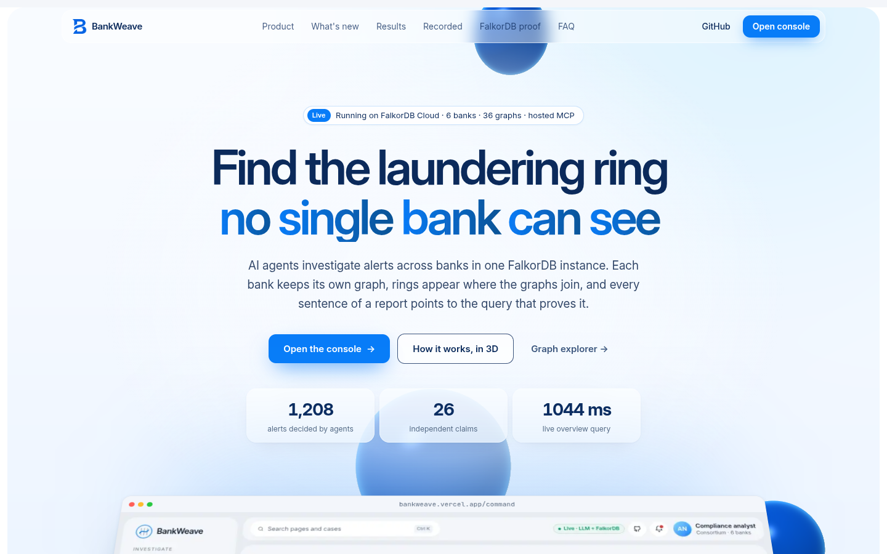

# Five paths, one fact: building AML agents that can't fool themselves

*How we built BankWeave on FalkorDB for Graph Hacks: one graph per bank, a consortium graph
that links them, and three research results turned into Cypher.*



**Try it:** [bankweave.vercel.app](https://bankweave.vercel.app) (live on FalkorDB Cloud) ·
[demo video](https://bankweave.vercel.app/#demo) · [source](https://github.com/LSUDOKO/BankWeave) ·
give your own AI agent the graph:
`claude mcp add --transport http bankweave https://bankweave-api.onrender.com/mcp`

## No bank can see a laundering ring alone

Anti-money-laundering teams drown in alerts. Rule-based monitoring looks at one signal at a
time (a large transfer, a cash deposit) and industry sources put 85-95% of those alerts as
false positives. Meanwhile the schemes that matter are deliberately spread across
institutions: money hops from a customer at one bank to a mule at a second and back through a
third. Each bank sees a slice that looks harmless. IBM's synthetic AML dataset documentation
says the same thing: a real institution only sees part of the laundering.

So we asked a narrow question: what does an investigation agent look like when the shape of
the money is the evidence, and the agent has to prove every sentence it writes?

## Laundering is a path, so we stored it as one

BankWeave loads IBM's AMLworld data (HI-Small) into FalkorDB as **many graphs in one
instance**:

- `bank_<id>`: one bank's view. Its own accounts, plus stubs for counterparties elsewhere, and
  only the transfers that touch the bank.
- `consortium`: every account at the selected banks, ids salted and hashed, all transfers.
- `case_<id>`: one graph per investigation, holding claims, evidence, actions and the agents'
  timeline.

That layout is the point. FalkorDB's multigraph maps directly onto how banks are allowed to
see data, and the same Cypher runs against any view. When we switch the UI from "Bank 001
only" to "Consortium", the same accounts go from scattered pieces to one connected structure
across four banks.

We measured it on IBM HI-Small with the 20 busiest banks. Across 36 laundering groups
that span banks (about 3.5 banks each), the best-placed single bank holds
only **43.8%** of a ring's accounts, and in **0%** of cases does one bank
hold the whole ring. It does see 95.7% of the laundering transfers, but most
counterparties are other banks' customers it can't run KYC on or investigate. The consortium graph
holds all of them.

## Algorithms as tools, not as a dashboard

The agents (Triage, Investigator, Skeptic, Reporter, Auditor, Archivist) don't compute
anything themselves. They call tools, and the tools are FalkorDB queries:

- `algo.wcc` and precomputed component sizes let Triage clear isolated accounts instantly
- `algo.SPpaths` gives the money path that becomes a claim's primary evidence
- `algo.pageRank`, `algo.betweenness` and `algo.HarmonicCentrality`, run on the copied case
  graph, find the hub, the bridges and the orchestrator
- `algo.maxFlow` over collapsed `FLOWS` edges gives "money at risk"
  (it refuses multi-edge relationship types, which is why `FLOWS` exists)
- full-text with Double Metaphone matches "Jon Smyth" to "John Smith"; a vector index finds
  accounts that behave like a known mule

Every tool returns the Cypher it ran, and every piece of evidence stores it. The same tools
are exposed over MCP, so Claude Desktop can investigate the graph directly.

## Five paths, one fact

Here's the failure that surprised us most. An investigator found a shared device between two
suspicious accounts. Then it found the same device again from the second account, and again
through a third account that also used it. Three supporting paths, so: high confidence?

No. It's one fact seen three times. The GraphEcho paper (arXiv 2609.17695) measured exactly
this: graph agents treat redundant paths to one origin as extra corroboration, and simply
telling the model to count sources barely helps. What worked was deterministic: group the
evidence by origin before the model sees it.

In BankWeave every `Evidence` node has an `origin`, the atomic fact it rests on
(`attr:D00063`, `flow:a->b`, `typ:cycle:acct`). Confidence is one query:

```cypher
MATCH (c:Claim {id:$id})-[:SUPPORTED_BY]->(e:Evidence)
WHERE e.state IN ['active', 'needs_verification']
RETURN count(e) AS paths, count(DISTINCT e.origin) AS independent_sources
```

On one real IBM case the ring claim shows "11 paths, 10 independent sources" with the naive figure beside it, and a shared
address in a 200-unit building is weighted down because it's weak evidence.

## When a reason dies, everything resting on it notices

Beliefs go stale. A KYC update arrives: address A-77, which three suspicious accounts share, is
a 200-unit residential building. The shared-address evidence was never wrong, but it no longer
means what the agents thought.

Following PACMI (arXiv 2610.05732) we never delete. Evidence moves along a validity lattice
(`active < needs_verification < historical_only < superseded`) and the change cascades over
typed edges: claims that rest on it, claims derived from those, the freeze recommendation
justified by them, and the report sentences that cite them. In the UI they turn amber. A
premise check runs before approval: "This rests on evidence superseded (A-77 is a 200-unit
residential building). Re-verify before acting." Approving anyway needs a written override.

## A report that can't prove itself doesn't get filed

The last failure is the most dangerous for a compliance product: a fluent summary that invents
agreement. The Active Provenance Gate paper (arXiv 2609.31422) found that when the same model
writes and audits, it wrongly approved unsafe summaries 85.6% of the time.

BankWeave's Reporter drafts the SAR from a closed bundle, every sentence citing ids. Code checks
run first (does the id exist, belong to this case, still hold?), then a *different, stronger*
model judges each sentence against only what it cites. The SAR publishes only when at least 95%
of sentences are supported, after at most three repairs. Otherwise the output is a divergence
report: the Investigator's position and the Skeptic's, side by side, each with its evidence.
We also refuse a recommendation that rests on a claim below 0.5 echo-proof confidence, so
contested cases end as divergence reports rather than confident SARs.

## Agents that live in the graph

The agents coordinate through a blackboard of `Task` nodes. Claiming a task is one atomic query
(we checked: six concurrent workers, every task done exactly once). Workers heartbeat; kill one
mid-investigation and the orchestrator resets its stale tasks, and another worker continues from
the case graph. Episodic memory is the case's `Event` timeline, procedural memory is a graph of
tool sequences that led to approved outcomes, and cross-case recall is a mirrored
`Account <-[:ABOUT]- Claim` edge in the consortium.

## Reproducing a 2026 AML paper inside FalkorDB

"Feed-Guided Shortest Paths" (arXiv 2610.13280) scores accounts by local motifs (3-cycles,
reciprocity, relay potential, fan-in/out, leaf stars), picks coherent seeds, and builds
shortest-path investigation subgraphs. We rebuilt it with FalkorDB: motif scores written to
`Account`, ego networks copied into a scratch graph, `algo.betweenness` and `algo.pageRank`
(standing in for eigenvector centrality) to pick intermediaries, `algo.SPpaths` for the paths.

Our result is an honest miss. With 200 seeds and radius 1, random seeds give a
3.4% illicit subgraph (paper: 2.4%) and degree-imbalance seeds 17.0%
(paper: 13.7%), but the paper's motif score gives only 7.5% (paper: 22.6%). The diagnosis
is in the data: on our 20-bank slice the illicit accounts are the busier ones, so the score's
degree penalty inverts it (account-level AUC 0.3743). Without the penalty it rises to
0.638, and that post-hoc variant gives 11.6%. Parameters tuned on one
graph didn't transfer to another, and we report that rather than tune on the test labels.

## What we measured

Every number here comes from a script in `eval/` and a JSON file in `eval/results/`.

**Triage** (4,000 alerted accounts from the later half of the period, 129 of them illicit,
a 3.2% base rate; everything tuned on the earlier half):

| Method | Precision | Recall | F1 | Accounts escalated |
|---|---|---|---|---|
| Rule-based: escalate everything | 3.2% | 100% | 0.062 | 4,000 |
| Rules without the graph | 33.3% | 7.8% | 0.126 | 30 |
| Graph score, hand weights | 18.9% | 14.0% | 0.161 | 95 |
| Graph score, calibrated | 17.8% | 24.0% | 0.205 | 174 |

The graph-calibrated triage escalates 174 accounts instead of 4,000, at about
5.5x the base rate's precision while keeping 24% recall. That is a real
improvement and also clearly not a solved problem: most illicit accounts in IBM's data look
locally ordinary, which is exactly why the consortium view matters.

**Pass-through matching** flagged 708 accounts, 4.8% of them illicit against a 2.5% base rate.

**Trust layer, on the 28 cases the agents actually built:** 27.8% of evidence items
repeated an origin already seen, and 37 of 101 claims had more paths than independent
sources; mean confidence fell from 48.8% (path counting) to 41.7% (distinct origins).
25 of 28 SARs passed the provenance gate (mean fidelity 0.988) and 3 ended as divergence
reports. The cascade flagged exactly the true dependents in 50 scripted dependency graphs
(recall and precision 100%).

## What we learned building it

- FalkorDB caps result sets at 10,000 rows by default; large reads need paging or they are
  silently truncated. We found it because 28,307 accounts came back as 10,000 motif scores.
- An unlabelled `MATCH (n {id:$id})` can't use an index. Labelling endpoints turned an edge load
  that would have run for hours into minutes.
- Unbounded variable-length cycle queries explode at hub accounts. A time-respecting expansion,
  one query per hop following only later transfers, is both faster and closer to what a
  laundering cycle is.

## 2.0: more of the engine, more of the evidence

The second version pushed more of the work into FalkorDB itself.

- **Time-respecting reach as a UDF.** Money cannot leave an account before it arrives. Our
  `aml_temporal` library is JavaScript loaded with `GRAPH.UDF LOAD`; it walks outgoing
  `TRANSFERS` with `getNeighbors` and only follows later transfers. From one busy account it
  returned 50 time-ordered reachable accounts in 44 ms, inside the database. FalkorDB's FLEX
  library (loaded the same way) does the fuzzy name and attribute-set similarity.
- **What-if on a copy.** "What happens if we freeze this account?" is `GRAPH.COPY` of the case
  graph, a `DETACH DELETE` in the copy, and `algo.maxFlow` plus `algo.wcc` before and after. On
  one four-bank case, freezing the account that carried the most flow took the ring's max flow
  from 49,475 to 0 and split it into seven pieces. The copy took 94 ms and is deleted after.
- **One query, three indexes.** A phonetic full-text match finds a person from a misspelt
  name, the HNSW vector index finds accounts that behave like theirs, and `algo.SPpaths` over the
  collapsed `FLOWS` edges shows how money connects them, all in one Cypher statement (about
  10 ms). We learned the hard way to run that path search over `FLOWS`: undirected `SPpaths` over
  multi-edge `TRANSFERS` on the whole consortium explodes, and procedure calls ignore the query
  timeout, so the Lab clamps path depth and direction before it runs anything.
- **A seal on every approval.** A case's claims, evidence (with the query that produced it and
  its validity state) and report sentences are hashed into one Merkle root. Approvers sign that
  root with a passkey (WebAuthn, ES256); if any evidence is superseded later, the root changes
  and the UI shows "Merkle seal broken".
- **Private set intersection.** Two banks find which devices, IPs and addresses their customers
  share with ECDH over Curve25519 without revealing the rest: 241 and 261 items, 93 shared,
  1,004 scalar multiplications, 80 ms.
- **Fitting a 100 MB cloud tier.** `GRAPH.MEMORY USAGE` and `INFO memory` showed where the space
  went: an edge index on transaction ids nothing looked up (about 8 MB), singleton identity
  nodes that can never be shared evidence, and id indexes on ~100-node case graphs (about
  110 KB each). Dropping them took a fresh load from 66.8 MB to 49.8 MB.

The card terminals, enclave and security key in the Hardware Lab are simulations and say so;
their EMV TLV encoding, hashes, signatures and key exchange are real.

## 3.0: open the graph to anyone, and prove it on real tools

A compliance tool is only as convincing as the evidence a sceptic can check for themselves, so
the last version was about opening BankWeave up.

- **Any AI agent can investigate.** A hosted MCP server, mounted inside the same API, exposes 17
  read-only tools: cases, echo-proof claims, money paths, rings, hubs, components, phonetic and
  vector search, triage and guarded Cypher. Every result carries the graph, the Cypher, its
  parameters and the time. Ask Claude whether a claim is proven and it gets the honest answer:
  three paths, one independent origin, 0.259 echo-proof against 0.593 by path counting.
  Writes are refused twice: by our guard, and by FalkorDB itself, because every call runs as
  `GRAPH.RO_QUERY`.
- **A graph explorer for humans.** Any read-only Cypher on any of the 36 graphs, drawn as an
  Obsidian-style force graph with labels and hover neighbourhoods. Twelve presets each show
  one engine feature on our data: the cross-bank ring, `algo.pageRank`, `algo.labelPropagation`,
  `algo.wcc`, `algo.SPpaths`, Double Metaphone search, HNSW KNN and a report's provenance chain.
- **A 3D explainer.** Eight scroll-driven scenes, from six bank slices that each see only themselves to
  a Merkle root signed by a hardware key. Every number on screen comes from the API, and every
  scene shows the Cypher behind it.
- **Proof on tools we don't control.**

  

  Our ESP32 card terminal, running in the Wokwi simulator, posts a real tap over HTTPS to the
  live API. The API approves it and writes a `CARD_TXN` edge into FalkorDB Cloud, and EMVLab
  decodes the exact chip data it printed. Then we opened FalkorDB's own browser against our
  instance: the cross-bank ring in 1.85 ms, PageRank in 3.55 ms, a report's
  SAR → sentence → claim → evidence chain in 0.61 ms, and behaviour twins at five banks in 0.36 ms.

## What shipping on a managed graph taught us

- **Budget memory like a feature.** The free tier is 100 MB with `noeviction`. When we hit the cap,
  writes stopped, and so did index creation when the API started. We made startup DDL tolerant,
  and wrote a capacity guard that reads `GRAPH.MEMORY USAGE` and prunes the oldest unpinned case
  graphs before the limit. A graph per case is great for isolation, but you have to garbage-collect
  it.
- **Read-only is the right default for agents.** Giving an LLM a database is safe when the engine
  enforces it. `GRAPH.RO_QUERY`, plus a guard that rejects write clauses and `GRAPH.*` commands,
  let us publish a Cypher endpoint and an MCP server without fear.
- **Return the query with the answer.** Every tool returning its Cypher turned out to be the most
  useful design decision. Auditors can rerun it, the explainer can show it, and when an agent is
  wrong you can see exactly which query misled it.
- **Read-heavy pages need parallel reads.** Per-case reads over a network round trip added up. Running
  them concurrently cut the dashboard's overview from 5.3 s to 1.6 s on the same Cloud instance.
- **Managed tiers differ.** Per-graph ACLs worked on self-hosted FalkorDB and were refused on Cloud, so the
  Lab shows both honestly instead of pretending.

## Limits and next steps

Synthetic data only; our identity layer is generated (and its rules published so leakage can
be audited). Consortium ids are salted hashes; the PSI handshake is real cryptography but both sides run in
one process for the demo. Clue-guided recovery uses graph signals, not the paper's GNN. Next:
PSI across real separate deployments, a learned risk field, and a study with real analysts.

*BankWeave is open source: [github.com/LSUDOKO/BankWeave](https://github.com/LSUDOKO/BankWeave). Live at [bankweave.vercel.app](https://bankweave.vercel.app). Built for Graph Hacks with help from Claude Code.*
