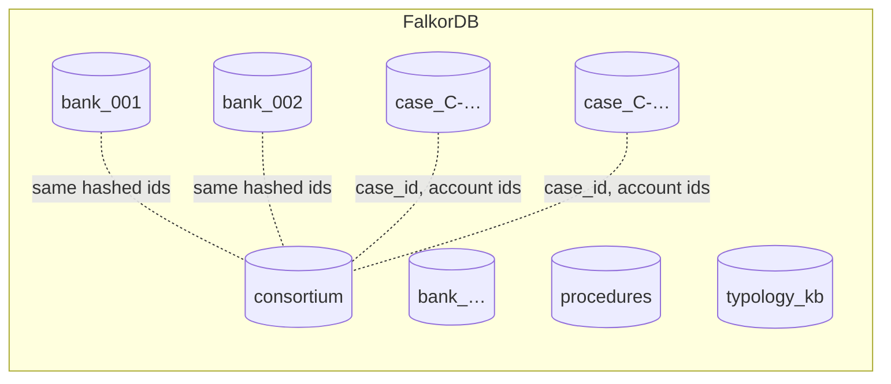

# BankWeave graph model

BankWeave keeps everything in FalkorDB: the money, the identities, the investigations, the
agents' coordination and their memory. One FalkorDB instance hosts many isolated graphs.

## Multigraph layout

| Graph | Holds | Written by |
|---|---|---|
| `consortium` | Every account at the selected banks (salted SHA-256 ids), all transfers, collapsed `FLOWS`, identity layer, alerts, the task blackboard, case and claim mirrors for cross-case recall | loader, baseline rules, agents |
| `bank_<id>` | One bank's partial view: its own `Account`s, `ExternalAccount` stubs for counterparties elsewhere, only transfers touching the bank | loader |
| `case_<id>` | One investigation: copied accounts and transfers, `Claim`, `Evidence`, `Action`, `SAR`, `Sentence`, `Event` timeline | agents |
| `procedures` | Procedural memory: tool sequences that worked | Archivist |
| `typology_kb` | Named typologies, indicators and source chunks | knowledge builder |

Graphs can't hold edges to each other; they reference each other by the same string ids
(`account id`, `case_id`).

## Financial layer (`consortium`, `bank_<id>`)

| Label | Key properties |
|---|---|
| `Account` | `id` (hash), `bank_id`, `in_deg`, `out_deg`, `first_seen`, `last_seen`, `behavior_vec` (vecf32, 16 dims), `pagerank`, `component`, `component_size`, `community`, `motif_score` (+ components), `passthrough_pairs`, `passthrough_value` |
| `ExternalAccount` | `id`, `bank_id` (bank graphs only: an account the bank doesn't hold) |
| `OtherBank` | `id`, `bank_id` (sink for banks outside the selection) |
| `Bank` | `id`, `name` |
| `Person` / `Company` | `id`, `name`, `name_norm` (spelling variants are separate nodes) |
| `Device` / `IP` / `Address` | `id`, `shared_count`, `units`, `text` |
| `Alert` | `id`, `account_id`, `rule`, `ts`, `status` (open, cleared, case), `reason`, `signals` |
| `Decision` | triage outcome and reason |
| `Task` | blackboard: `type`, `status` (todo, claimed, done, failed), `assignee`, `hb`, `round` |
| `Meta` | dataset and precompute provenance |

| Relationship | From → To | Properties |
|---|---|---|
| `TRANSFERS` | Account → Account (or stub) | `txn_id`, `ts`, `amount`, `amount_recv`, `cur`, `cur_recv`, `format`, `capacity` |
| `FLOWS` | Account → Account | `capacity` (sum), `n_txn`: one edge per ordered pair, for `algo.maxFlow` and the motif score |
| `HELD_AT` | Account → Bank | |
| `OWNS` | Person/Company → Account | `name_on_account`, `valid_from` |
| `USES_DEVICE` / `USES_IP` / `REGISTERED_AT` | Account → Device / IP / Address | |
| `RAISED_FOR` | Alert → Account | |
| `DECIDED` | Alert → Decision | |
| `OPENED_FROM`, `CONCERNS`, `HAS_CLAIM` | Case mirrors → Alert / Account / Claim | |

## Investigation layer (`case_<id>`)

| Label | Key properties |
|---|---|
| `Case` | `status`, `seed_alert`, `seed_account`, `bank_scope`, `title` |
| `Claim` | `text`, `kind` (ring, hub, mule, structuring, innocent), `state`, `confidence`, `naive_confidence`, `paths`, `independent_sources`, `independent_challenges` |
| `Evidence` | `kind`, **`origin`** (independent-source atom), `summary`, `payload`, `cypher` (the query that produced it), `state`, `superseded_reason` |
| `Action` | `kind` (file_sar, freeze_rec, escalate, close), `status` (proposed, approved, rejected), `state`, `note` |
| `SAR` / `Sentence` | `status` (published, divergent), `pf_score`, `repairs`; sentence `supported`, `verdict` |
| `Event` | episodic memory: `agent`, `action`, `payload`, `cypher` |
| `Typology` | mirror of the knowledge-graph entry a claim matches |

| Relationship | Meaning |
|---|---|
| `SUPPORTED_BY` / `CHALLENGED_BY` | Claim → Evidence |
| `DERIVED_FROM` | Claim → Claim |
| `JUSTIFIED_BY` | Action → Claim |
| `CONTAINS` / `CITES` | SAR → Sentence → Evidence or Claim |
| `SUPERSEDES` | new Evidence → old Evidence (history is kept) |
| `MATCHES_TYPOLOGY` | Claim → Typology |
| `HAD_EVENT` / `NEXT` | Case → Event → Event (timeline) |

Validity lattice on Evidence, Claim, Action, SAR and Sentence:
`active < needs_verification < historical_only < superseded` (the stronger state wins).

## Indexes

- Range: `Account.id`, `ExternalAccount.id`, `OtherBank.id`, `Bank.id`, `Alert.id`, `Alert.status`, `Task.id`, `Task.status`, `TRANSFERS.ts`, `TRANSFERS.txn_id`, identity ids, case-graph ids
- Full-text: `Person.name`, `Company.name` with Double Metaphone phonetic matching; `Chunk.text` with English stemming
- Vector: `Account.behavior_vec` (HNSW, 16 dimensions, cosine)

Every query is listed in [`QUERIES.md`](QUERIES.md).
